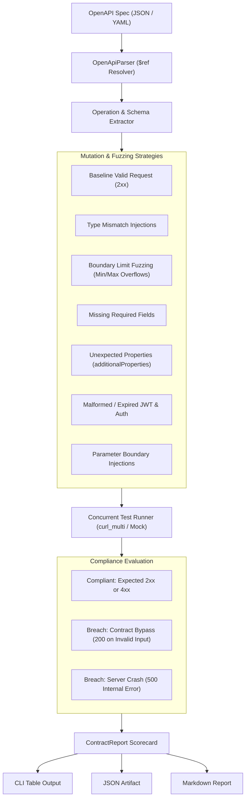

[🇸🇦 العربية](README.ar.md) | [🇬🇧 English](README.md)

# 🎯 eidcloud-api-contract-test

[](https://github.com/eidcloud/eidcloud-api-contract-test/releases)
[](https://www.php.net/)
[](LICENSE)
[](https://colab.research.google.com/github/eidcloud/eidcloud-api-contract-test/blob/main/notebooks/quickstart.ipynb)
[](.github/workflows/ci.yml)

> **Automated OpenAPI contract fuzzer and boundary testing suite generating mutation test cases in pure PHP 8.2+ with zero external dependencies.**

---

## 📌 Topics

`eidcloud` • `api-contract-testing` • `openapi-fuzzer` • `boundary-testing` • `api-testing` • `qa-automation` • `php8`

---

## 🏛️ Architecture Workflow



---

## ✨ Core Capabilities

- **Zero Vendor Dependencies**: Built strictly using pure PHP 8.2+ standard libraries (`ext-curl`, `ext-json`, `ext-mbstring`).
- **OpenAPI 3.0 / 3.1 Spec Parser**: Ingests contracts and recursively resolves nested `$ref` schema definitions and components.
- **Exhaustive Mutation Generation**:
  - **Type Mismatch**: Injects strings into integer fields, objects into arrays, and invalid scalars into nested structures.
  - **Boundary Limits**: Fuzzes `PHP_INT_MAX`, `PHP_INT_MIN`, `minimum - 1`, `maximum + 1`, empty strings, and oversized payloads.
  - **Missing Required Properties**: Isolates each mandatory field to verify strict server-side validation.
  - **Unexpected Property Injections**: Probes for strict schema filtering and undeclared field rejection.
  - **Malformed & Expired Auth**: Fuzzes headers with missing tokens, malformed formats, and expired JWT signatures.
  - **Parameter Injections**: Fuzzes path and query parameters with boundary syntax probes and traversal sequences.
- **Concurrent Test Execution**: Asynchronous batch execution engine leveraging native PHP `curl_multi` handles for high-throughput testing.
- **Contract Breach Classification**:
  - `CONTRACT_BYPASS`: Detects when an API endpoint incorrectly accepts invalid/mutated data with HTTP `200 OK`.
  - `SERVER_CRASH`: Detects unhandled exceptions where an API returns HTTP `500-599` instead of graceful `4xx` validation errors.
  - `BASELINE_FAILURE`: Detects when an API fails to process valid contract requests.
- **Dual Execution Engine**: Supports testing against live HTTP targets and an in-memory Mock Validation Simulator for offline CI/CD checks.

---

## 🚀 Installation

```bash
# Clone the repository
git clone https://github.com/eidcloud/eidcloud-api-contract-test.git
cd eidcloud-api-contract-test

# Ensure execution permissions for the CLI binary
chmod +x bin/eidcloud-contract
```

---

## 💻 CLI Usage

The executable binary is located at `bin/eidcloud-contract`:

```bash
php bin/eidcloud-contract --help
```

### 1. Fuzzing a Live Target

```bash
php bin/eidcloud-contract fuzz openapi.json \
    --target=https://api.example.com \
    --concurrency=10 \
    --output=results.json \
    --fail-on-breach
```

### 2. Running in Mock Simulation Mode

Run fuzzer validation offline without needing an active backend service:

```bash
php bin/eidcloud-contract fuzz tests/fixtures/petstore.json \
    --mock \
    --output=results.json \
    --format=table
```

### 3. Generating Reports from Stored Results

```bash
# Render CLI formatted scorecard table
php bin/eidcloud-contract report --in=results.json --format=table

# Render GitHub-flavored Markdown
php bin/eidcloud-contract report --in=results.json --format=markdown
```

---

## 🧪 Programmatic PHP Usage

```php
<?php

use EidCloud\ApiContractTest\ContractTester;

require_once __DIR__ . '/vendor/autoload.php'; // Or native PSR-4 loader

// Initialize Contract Tester
$tester = ContractTester::create(
    targetUrl: 'http://localhost:8080/v1',
    concurrency: 8,
    mockMode: false
);

// Load OpenAPI Specification
$tester->loadSpecFromFile('tests/fixtures/petstore.json');

// Run full mutation fuzzer suite with progress tracking
$report = $tester->run(function ($result, int $done, int $total) {
    echo "Completed {$done}/{$total}: " . $result->getTestCase()->getPath() . PHP_EOL;
});

// Access Scorecard Metrics
echo "Compliance Score: " . $report->getComplianceScore() . "%\n";
echo "Total Tests: " . $report->getTotalTests() . "\n";
echo "Breaches: " . $report->getBreachTests() . "\n";

// Save outputs
$report->saveToFile('compliance-report.json');
echo $report->renderCliTable();
```

---

## 📊 Sample CLI Output

```text
================================================================================
               EIDCLOUD API CONTRACT & BOUNDARY FUZZING REPORT                  
================================================================================
Specification : Swagger Petstore - EidCloud Contract Evaluation
Target URL    : http://localhost:8080/v1
Execution Time: 0.12s  |  Avg Latency: 6.4ms
--------------------------------------------------------------------------------
COMPLIANCE SCORE: 100.0%  [42 / 42 Tests Passed]
BREACHES: 0  (Contract Bypasses: 0 | Server Crashes: 0 | Baseline Fails: 0)
--------------------------------------------------------------------------------
MUTATION CATEGORY                |  TOTAL |   PASS | BREACHES |   SCORE
---------------------------------+--------+--------+----------+---------
Baseline Contract                |      4 |      4 |        0 |  100.0%
Parameter Boundary Injection     |      9 |      9 |        0 |  100.0%
Type Mismatch Injection          |     11 |     11 |        0 |  100.0%
Boundary Limit Fuzzing           |      9 |      9 |        0 |  100.0%
Missing Required Field           |      2 |      2 |        0 |  100.0%
Unexpected Property Injection    |      1 |      1 |        0 |  100.0%
Malformed / Expired Auth         |      6 |      6 |        0 |  100.0%
================================================================================
```

---

## 🧪 Testing

Execute the automated zero-dependency test suite:

```bash
php tests/run_tests.php
```

---

## 👤 Author & Maintainer

**Eng. MHD. Shadi AL-Hasan**  
- **Role:** Executive CTO & Enterprise Solutions Architect  
- **Email:** [mhd.shadi.alhasan@gmail.com](mailto:mhd.shadi.alhasan@gmail.com)  
- **Phone / WhatsApp:** [+963934005922](tel:+963934005922)  
- **Location:** Damascus, Syria  
- **GitHub:** [shadialhasan](https://github.com/shadialhasan)  

---

## 📄 License

This project is licensed under the MIT License - see the [LICENSE](LICENSE) file for details.  
Copyright (c) 2026 **MHD. Shadi AL-Hasan**. All rights reserved.
